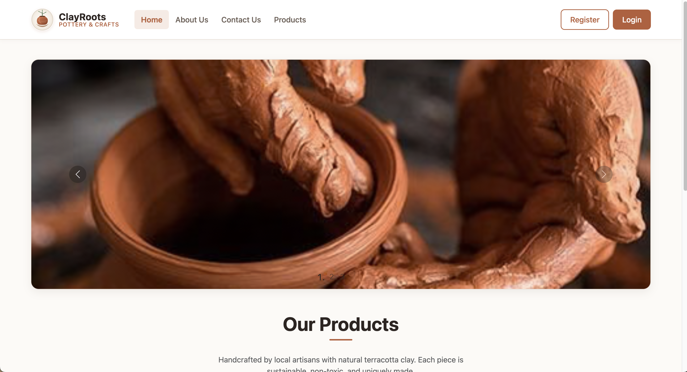
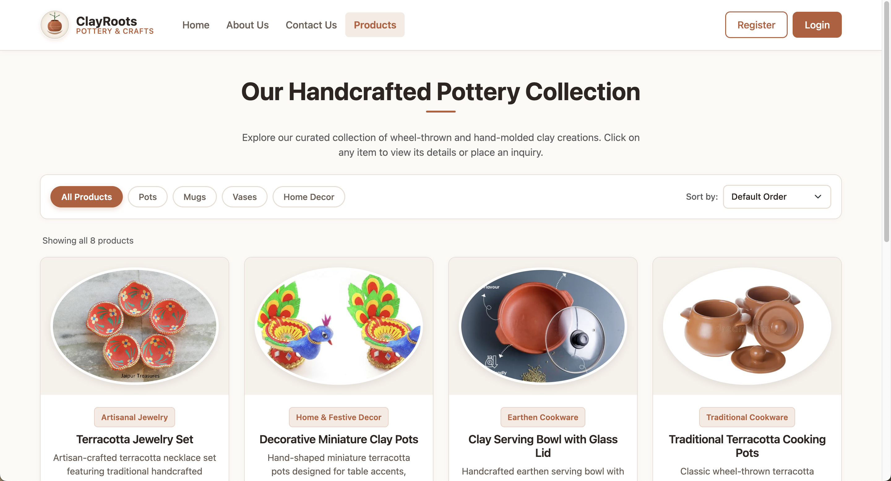
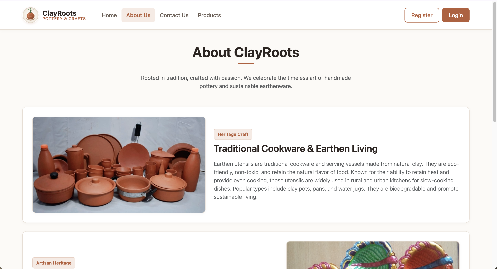
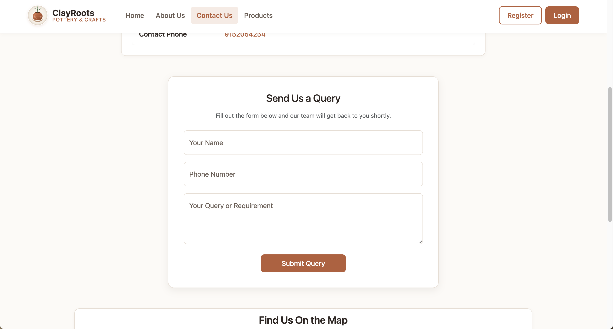
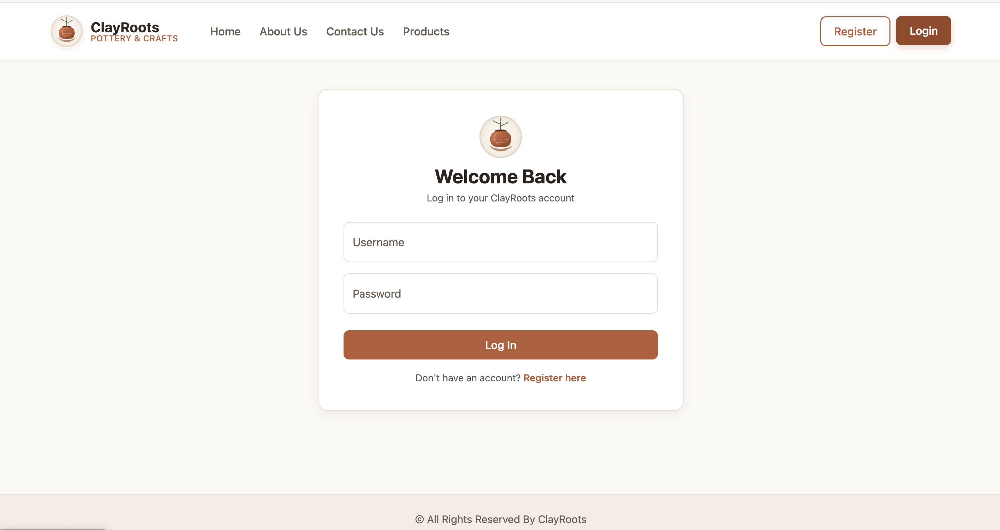
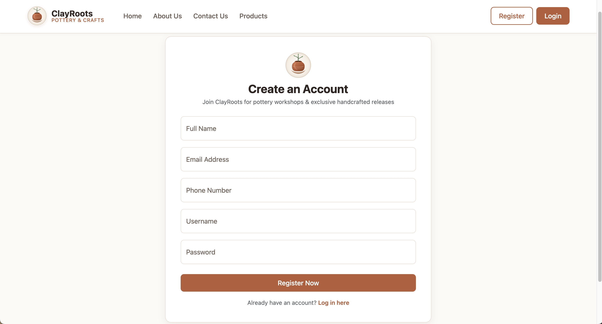

# ClayRoots 🏺

ClayRoots is a pottery-themed frontend website concept that celebrates traditional clay craftsmanship through a clean, warm, and user-friendly web interface.

## ✨ Features

- **Home Page:** Introduces the ClayRoots concept with a pottery-inspired design.
- **Product Showcase:** Displays pottery products with interactive product details.
- **Product Details Modal:** View information about selected products using Bootstrap modals.
- **Fixed Navigation Bar:** Keeps navigation accessible while scrolling across all pages.
- **Login & Registration:** Dedicated login and registration interfaces.
- **About Us:** Shares the story and purpose behind ClayRoots.
- **Contact Us:** Provides a dedicated contact page.
- **Responsive Layout:** Adapts to desktop and mobile screens.
- **Light Theme:** Consistent white backgrounds with warm terracotta accents.
- **Subtle UI Effects:** Includes gentle transitions and hover effects.

## 🛠️ Tech Stack

- HTML5
- CSS3
- Bootstrap
- JavaScript

## 📸 Screenshots

The following screenshots showcase the ClayRoots website interface as part of version v0.2.0.

### Homepage


### Product Page


### About Us Page


### Contact Us Page


### Login Page


### Registration Page


## 🚀 Getting Started

1. Clone or download this repository.
2. Open the project folder.
3. Open `index.html` in your browser.

Alternatively, run a local static server from the project directory:

```bash
python3 -m http.server 8000
```

Then visit `http://localhost:8000` in your browser. Python is only an optional way to serve the static files locally; the project itself is built with HTML, CSS, Bootstrap, and JavaScript.

## 📌 Project Status

ClayRoots is a frontend implementation. Product details and interface interactions are demonstrated on the client side. It does not currently include a connected backend, persistent user accounts, database storage, or integrated payment processing.

## 🎯 Project Purpose

This project explores frontend web development and responsive UI design through a pottery-inspired concept that highlights traditional craftsmanship.

---

*Built as a frontend learning project.*
